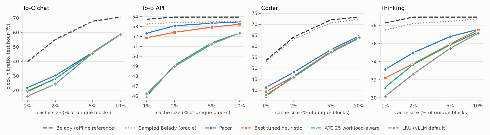
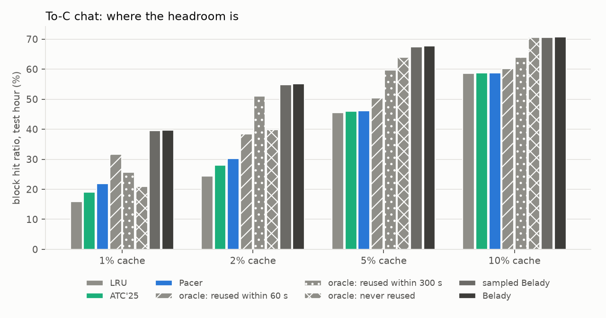
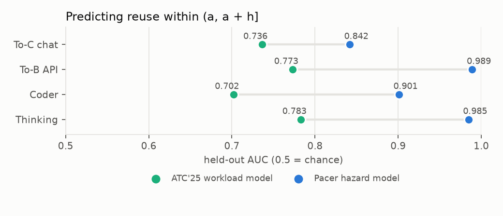

# Pacer

[](https://github.com/JMBugarin/pacer/actions/workflows/ci.yml)
  

**Learned eviction for LLM prefix (KV) caches, tested on Alibaba's public Qwen production
traces.** A Rust trace-driven simulator of a vLLM-style prefix cache, a reuse model trained in
about a minute per workload, and a live check that drives a real paged KV pool in MLX on a Mac.



*Held-out hour of each trace. Pacer (blue) against LRU, the ATC'25 workload-aware policy, the
best heuristic for each cell (chosen with hindsight on the held-out hour) and the offline
reference bounds. Each panel has its own y scale.*

## Why

When a chat turn or an agent step arrives, an LLM server reuses the KV cache of any prompt
prefix it still holds and computes only the rest. Whether that prefix is still there is an
eviction decision, and vLLM makes it in LRU order. On the chat trace used here the offline
reference (Belady) gets 2.3-2.5x LRU's hit ratio at 1-2% cache sizes (1.1-1.4x on the other
traces). A September 2026 study of 14 eviction policies on production prefix-cache traces,
three of them learned, found they "provide little benefit over LRU" (Liu, Yu, Yang, *When Fancy
Eviction Fails*). None of those policies uses what an LLM server knows about each request.

Pacer asks one question about every candidate block: *will it be used again before it would
have been evicted anyway?* A small gradient-boosted model estimates
P(next use within (a, a + h] | unused for a seconds), where `h` is the cache's own recent
eviction age, and Pacer evicts the least likely block among a small random sample.

## Results

Held-out hour 2 of each trace, block hit ratio in %. Pacer uses one fixed configuration for
every trace and size; each trace gets its own model, trained on its own first 45 minutes. The
interval is a paired 95% t-interval over the hour's twelve 5-minute buckets, in points.

<!-- results:main -->
| Trace | Cache | LRU | Best tuned heuristic | ATC'25 | **Pacer** | Pacer vs best (95% CI) | Belady |
|---|---|---|---|---|---|---|---|
| To-C chat | 1% | 15.88 | 19.58 (S3-FIFO) | 19.04 | **21.85** | +2.27 [+1.80, +2.75] | 39.77 |
| To-C chat | 2% | 24.36 | 27.97 (ATC'25) | 27.97 | **30.19** | +2.23 [+1.47, +2.98] | 55.16 |
| To-C chat | 5% | 45.60 | 46.06 (ATC'25) | 46.06 | **46.16** | +0.10 [-0.60, +0.80] | 67.77 |
| To-C chat | 10% | 58.57 | 58.74 (ATC'25) | 58.74 | **58.78** | +0.04 [-0.27, +0.35] | 70.68 |
| To-B API | 1% | 46.23 | 51.87 (ARC) | 45.97 | **52.32** | +0.46 [+0.34, +0.57] | 53.74 |
| To-B API | 2% | 48.97 | 52.42 (S3-FIFO) | 49.10 | **53.08** | +0.66 [+0.57, +0.76] | 53.96 |
| To-B API | 5% | 51.22 | 52.94 (S3-FIFO) | 51.36 | **53.34** | +0.40 [+0.30, +0.50] | 53.96 |
| To-B API | 10% | 52.36 | 53.23 (S3-FIFO) | 52.34 | **53.46** | +0.23 [+0.16, +0.30] | 53.96 |
| Coder | 1% | 37.81 | 39.30 (GDSF) | 37.25 | **41.26** | +1.96 [+1.63, +2.29] | 53.53 |
| Coder | 2% | 45.89 | 46.42 (ATC'25) | 46.42 | **48.17** | +1.75 [+1.27, +2.22] | 64.26 |
| Coder | 5% | 57.31 | 57.66 (ARC) | 57.21 | **58.47** | +0.82 [+0.33, +1.30] | 72.03 |
| Coder | 10% | 64.01 | 64.01 (LRU) | 63.68 | **64.62** | +0.62 [+0.22, +1.01] | 73.29 |
| Thinking | 1% | 30.17 | 32.18 (ARC) | 31.15 | **33.13** | +0.95 [+0.27, +1.63] | 38.27 |
| Thinking | 2% | 32.61 | 33.76 (ARC) | 33.67 | **34.97** | +1.21 [+0.66, +1.75] | 38.91 |
| Thinking | 5% | 35.46 | 35.93 (LRU+QD) | 35.84 | **36.76** | +0.83 [+0.59, +1.07] | 38.91 |
| Thinking | 10% | 37.14 | 37.50 (LRU+QD) | 37.27 | **37.55** | +0.05 [-0.23, +0.33] | 38.91 |

Pacer vs the best heuristic: better in 13 cells, statistically tied in 3, worse in 0.
<!-- /results:main -->

What this shows:

- **Pacer is never significantly worse than the best heuristic, and is significantly better in
  13 of 16 cells.** The comparison is strong: nine heuristics, five of them with settings tuned
  on validation, with the best one for each cell picked with hindsight on the test hour. The
  largest gains are at small caches: on chat at 1-2%, +2.2 to +2.3 points over the best
  heuristic and +5.8 to +6.0 over LRU.
- **Against the closest prior work**, ATC'25's workload-aware policy, the learned model ranks
  reuse much better on held-out time (AUC 0.84-0.99 against 0.70-0.78), and Pacer beats that
  policy in 13 of 16 cells and ties it in 3.
- **Chat at 5-10% capacity is where nothing online works.** The oracle ladder below shows the
  remaining headroom is knowing which conversations have ended. From the trace's metadata,
  whether a chat continues at all is barely predictable (AUC 0.63, against 0.61 from the turn
  number alone), and on the few held-out rows with horizons of 5 minutes or more the model is no
  better than ATC'25's on chat.
- **The model does not transfer across workloads.** Each trace needs its own model; a model
  trained on single-turn API traffic is far worse than LRU on chat at larger sizes.
- **Weighted by compute, the chat lead holds only at 1%.** Deep blocks cost more to recompute
  (measured on the M5 Pro). By compute saved, Pacer still leads on API, coder and most thinking
  cells and on chat at 1% (17.8% against 12.6%), but on chat at 2-10% it trails ATC'25 by 0.6-1.1
  points: it tends to evict long conversations. Scoring by expected saved compute is the next
  step.
- **Cheap enough for the eviction path.** The fixed configuration costs 49-230 ns per evicted
  block on one core, less than our heap-based LRU (255-453 ns).
- **Live, the effect is real but small at laptop scale.** On 400 held-out chat requests replayed
  through a real paged KV pool in MLX, Pacer prefilled 1.9% fewer tokens than LRU and cut mean
  time to first token by 1.2% (95% CI 0.1-2.4%); perfect knowledge (sampled Belady) gets 2.7%.
  Cached-prefix prefill matched full prefill's next token in 97.5% of 200 checks, and in all of
  them where the top-2 margin was clear.

| Where the headroom is (chat) | Predicting reuse on held-out time |
|---|---|
|  |  |

All tables, ablations, transfer, cost and the live replay: [docs/results.md](docs/results.md).
How it was built, including what did not work: [docs/engineering-log.md](docs/engineering-log.md).
The design decisions and how to defend them: [docs/decisions.md](docs/decisions.md).

## How it works

1. **Traces.** Four public Qwen-Bailian traces (Apache-2.0): chat, API, coder and thinking
   traffic, 2 hours each, 270k requests, 35M block accesses. Block hashes are re-keyed by their
   whole prefix, and the blocks a server fills while decoding are cached at completion when the
   follow-up prompt contains the answer verbatim.
2. **Simulator.** Rust, event-driven, vLLM semantics: running requests pin their blocks and only
   unpinned leaves are evicted, so the cache stays prefix-closed. 16 policies: LRU, FIFO, LFU,
   SIEVE, S3-FIFO, ARC, GDSF, LRU with quick demotion, ATC'25, sampled LRU, oracles, Belady and
   Pacer. A Python reference simulator is the executable spec and matches the Rust one exactly
   on the eight deterministic baselines. [docs/simulator.md](docs/simulator.md)
3. **Model.** Training rows that do not depend on any cache: sampled block releases at random
   elapsed times and horizons, labeled only with events inside the training period. LightGBM
   with 13-37 trees, evaluated in Rust. [docs/method.md](docs/method.md)
4. **Policy.** Sample 32 evictable blocks, evict the least likely to be reused, follow the chain
   upward while the parent has the same history, and let one scored sample serve up to 4
   evictions of the same burst.
5. **Live check.** The same Rust controller, through PyO3, drives a paged bf16 KV pool for
   Qwen3-0.6B (4-bit weights) in MLX; only the uncached suffix is prefilled and time to first
   token is measured.

## Evaluation protocol

- Train on the first 45 minutes of hour 1, with every label resolved inside those 45 minutes.
  Make every choice (model early stopping, Pacer settings, heuristic settings, which ATC'25 fit)
  on minutes 45-60. Report hour 2.
- Tuned heuristics: S3-FIFO 24 settings, LRU with quick demotion 7, GDSF 4, ARC 2, ATC'25 2.
  Pacer's reported configurations: one fixed setting, and one with the horizon multiplier picked
  per cell from 3.
- Hour 2 was used more than once while the method was being developed: an exploratory sweep of
  the heuristics, one look at the first learned approach, and full runs of v1 and v2. The v2
  label fix was prompted by a weak v1 test cell. The numbers here are v3, after an adversarial
  review, run once from committed code. Every earlier look is in the
  [engineering log](docs/engineering-log.md) and `results/history/`.

## Run it

You need Rust and [uv](https://docs.astral.sh/uv/). On macOS, LightGBM also needs
`brew install libomp`.

```bash
make data      # download the four traces (~310 MB) and check their SHA-256
make demo      # one cache size on the chat trace: LRU, S3-FIFO, ATC'25, Pacer, Belady (~1 min)
```

The headline results, from a clean clone (about 4 hours on an M5 Pro, most of it the S3-FIFO
grid):

```bash
make reproduce # rows, models, validation, selection, test hour, tables, figures
make extras    # ablations, transfer, decision cost
make live      # MLX replay and prefill cost model (Apple silicon)
```

Checks and tests:

```bash
make check     # cargo fmt, clippy, cargo test, ruff, pytest
```

## Repository layout

| Path | What it is |
|---|---|
| `crates/pacer/` | Simulator, policies, features, GBDT evaluator, CLI (`pacer sim / sweep / hazard`) |
| `crates/pacer-py/` | PyO3 bindings used by the live replay |
| `python/pacer/` | Trace loading, reference simulator, model training, reports and figures |
| `python/pacer/live/` | MLX paged KV pool, prefill engine and replay |
| `configs/` | Sweep specifications; `configs/test*.json` are generated from validation |
| `results/` | Raw sweep output (JSON lines), summaries, and `history/` for earlier versions |
| `models/` | The trained models and ATC'25 fits behind the results |
| `docs/` | Method, simulator semantics, results, decisions, engineering log |

## Limitations

- Simulation, not a production deployment. The live replay runs a 0.6B model on a laptop with
  400 requests; it checks the mechanics and measures time to first token, not production gains.
- Two hours per trace and one temporal split; every number comes from one held-out hour, which
  was also looked at during development (see the protocol).
- Capacities are fractions of each trace's unique blocks. At 1%, running requests pin a large
  share of the cache.
- The traces carry no prompt content, only lengths, types, turns and block hashes. A real
  server knows more (tool calls, system prompt identity), which could change what is
  predictable.
- Per-workload models, and no guard yet against a model that stops fitting its traffic.
- Some selected heuristic settings sit at the edge of their grid (S3-FIFO's small queue at 1%
  of the cache in 5 of 16 cells).

## Data and license

Code: MIT. Traces: [Qwen-Bailian usage traces](https://github.com/alibaba-edu/qwen-bailian-usagetraces-anon)
(Apache-2.0), downloaded by `make data` at a pinned commit; small unmodified slices are
included for tests (see [THIRD_PARTY_NOTICES.md](THIRD_PARTY_NOTICES.md)).
